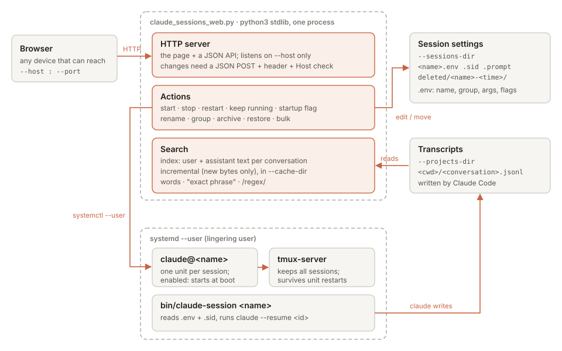

# claude-sessions-web

A small web page for running **many long-lived [Claude Code](https://docs.claude.com/en/docs/claude-code) sessions on one Linux machine**, each in its own tmux session under systemd, and for finding things in what was said in them.

- See every session: name, group, conversation id, running or stopped, last activity.
- **Keep running**: the session starts at boot (`systemctl --user enable`).
- **Startup flag**: marks the sessions a client-side script should open as terminal tabs when you log in.
- Start, restart, stop, **archive** and **restore**; rename and regroup. Every action also works on several selected rows at once.
- **Search the conversations**: words, `"exact phrases"` or `/regular expressions/` over everything you and Claude wrote, with results shown next to the table.

It is one Python file using only the standard library, plus one HTML file. No database, no build step, no container.



## How it works

**Sessions are plain systemd user units.** `claude@<name>.service` creates a tmux session `claude-<name>` inside a separate `tmux-server.service`, so restarting one session never kills the others. The tmux session runs `bin/claude-session <name>`. That script reads the session's settings, then starts `claude --resume <conversation-id>`, so a restart reopens the same conversation. You attach with `tmux attach -t claude-<name>` and detach with `Ctrl-b d`; the session keeps running.

**Settings live in one folder** (`--sessions-dir`, default `~/.config/claude-sessions/`):

| File | What it holds |
|---|---|
| `<name>.env` | `CLAUDE_NAME` (display name), `CLAUDE_GROUP`, `CLAUDE_ARGS` (extra `claude` flags), `CLAUDE_CWD` (default `~/work/<name>`), `CLAUDE_WINSTART` (startup flag, `1` or `0`). It is sourced by bash, so keep it mode 600. |
| `<name>.sid` | the conversation id to resume |
| `<name>.prompt` | optional: a first prompt, used once and then renamed to `.prompt.used` |
| `deleted/<name>-<time>/` | archived sessions: the files above, moved here |

**The web page** (`claude_sessions_web.py`) does three things:

1. **HTTP server**: serves the page and a small JSON API. It listens only on the addresses you give it (`--host`).
2. **Actions**: changes are calls to `systemctl --user`, edits of the `.env` file, or moves to and from `deleted/`. Archiving stops and disables the unit and moves its settings; the conversation itself is never touched. Restoring moves the settings back, and the session comes back stopped.
3. **Search**: Claude Code stores each conversation as a `.jsonl` transcript under `--projects-dir` (default `~/.claude/projects/`). The server pulls out only the user and assistant text, one line per message, into `--cache-dir`. That's a few MB even when the transcripts are several GB. Transcripts only grow, so each update reads just the new bytes. It refreshes every 5 minutes and before each search, so a search scans small text files and answers in well under a second.

## What you need

- Linux with **systemd user services**, and lingering turned on so sessions run without a login: `sudo loginctl enable-linger $USER`
- **tmux**
- **Python 3.9+** (standard library only)
- **Claude Code** (`claude` on `PATH`, usually `~/.local/bin`)
- A browser that can reach the address you bind: the same machine, an SSH tunnel, or a private network such as a VPN

## Install

```sh
git clone https://github.com/rafaelborja/claude-sessions-web ~/.local/share/claude-sessions-web
cd ~/.local/share/claude-sessions-web
install -m 755 bin/claude-session bin/claude-sessions-list bin/claude-sid-hook ~/.local/bin/
mkdir -p ~/.config/systemd/user && cp systemd/*.service ~/.config/systemd/user/
# edit ~/.config/systemd/user/claude-sessions-web.service: --host / --port (see Options)
systemctl --user daemon-reload
systemctl --user enable --now tmux-server claude-sessions-web
```

Open `http://127.0.0.1:8190/`, or whatever `--host` and `--port` you chose.

**Optional, recommended:** let Claude Code keep `<name>.sid` current after `/clear`. Add a SessionStart hook to `~/.claude/settings.json`:

```json
{
  "hooks": {
    "SessionStart": [
      { "hooks": [ { "type": "command", "command": "~/.local/bin/claude-sid-hook" } ] }
    ]
  }
}
```

Without the hook, a restart reopens the conversation recorded when the session was first started.

## Create a session

```sh
mkdir -p ~/.config/claude-sessions && cd ~/.config/claude-sessions
printf 'CLAUDE_NAME="My project"\nCLAUDE_GROUP=work\nCLAUDE_ARGS=\n' > myproject.env && chmod 600 myproject.env
systemctl --user enable --now claude@myproject      # enable = keep running (start at boot)
tmux attach -t claude-myproject
```

The session runs in `~/work/myproject` (set `CLAUDE_CWD` to change that) and appears on the page.

## Options

| Option | Default | Meaning |
|---|---|---|
| `--host ADDR` | `127.0.0.1` | address to listen on; repeat it for several (IPv4 or IPv6) |
| `--port N` | `8190` | port |
| `--name HOST` | this machine's hostname | another host name the page may be reached by (DNS or VPN name); repeatable |
| `--sessions-dir DIR` | `~/.config/claude-sessions` | session settings (above) |
| `--projects-dir DIR` | `~/.claude/projects` | Claude Code transcripts |
| `--cache-dir DIR` | `~/.cache/claude-sessions-web` | search index; safe to delete, it is rebuilt |

`bin/claude-session`, `bin/claude-sessions-list` and `bin/claude-sid-hook` read `CLAUDE_SESSIONS_DIR` from the environment if the settings live somewhere else.

## Search syntax

| You type | Finds messages that… |
|---|---|
| `deploy staging` | contain **both** words (in any order, ignoring case, parts of words match) |
| `"connection refused"` | contain the exact phrase |
| `/time ?out.{0,40}retry/` | match a Python regular expression (ignoring case) |
| `/TODO/c` | match a regular expression, case-sensitive |

It searches one message at a time and only the user and assistant text, not tool output. It returns up to 60 conversations, the most recently active first, each with its last three matching messages.

## Client-side startup tabs

`bin/claude-sessions-list` prints the running sessions as `name<TAB>display<TAB>group<TAB>startup-flag`. A login script on another machine can run it over SSH and open one terminal tab per session where the flag is `1`, for example `ssh -t <host> tmux attach -t claude-<name>`. The page's **Startup** checkbox sets that flag.

## Security

There is **no login**: anyone who can reach the port can stop, restart and archive sessions. So:

- Listen on `127.0.0.1` (the default) or on a private network address only. **Never expose it to the internet.**
- Changes need a JSON `POST` carrying the header `X-Claude-Sessions: 1`. A page on another site can't send that without a CORS preflight, which this server never grants.
- The `Host` header must be one of the bound addresses, `localhost`, this machine's hostname or a `--name`. That blocks DNS-rebinding tricks.
- Display names and groups are checked before they are written to the `.env` file, because bash sources it.

## Limits

- "Keep running" means started now and at boot. A session you leave with `/exit` stays stopped until you press **Start**.
- One machine: the page manages the sessions of the user it runs as, on the machine it runs on.
- Search covers conversations under `--projects-dir` (one level deep), not subagent transcripts.

## License

MIT, see [LICENSE](LICENSE).
